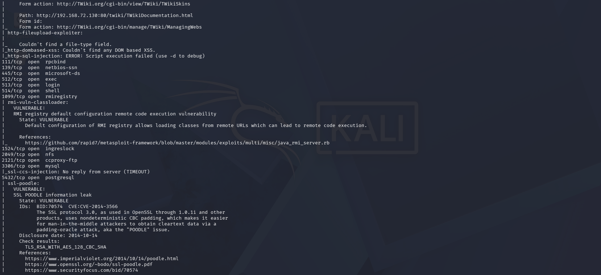

# Nmap Network Scanning and Enumeration Lab

# 1. Introduction

Nmap (Network Mapper) is an open-source tool used for network discovery and security auditing. It helps identify active hosts, open ports, running services, service versions, and operating systems.

This project demonstrates different Nmap scanning techniques using Kali Linux and Metasploitable 2 in a virtual lab environment. It includes Host Discovery, Port Scanning, Service and Version Detection, OS Detection, Vulnerability Scanning, and Aggressive Scanning.

The main purpose of this project is to gain practical knowledge of network scanning, understand exposed services, and learn basic security assessment techniques in an authorized environment.

# 2. Objectives

- To understand Nmap scanning techniques.
- To discover active hosts.
- To identify open ports.
- To detect services and versions.
- To identify the operating system.
- To perform vulnerability scanning.
- To analyze scan results.

# 3. Tools and Technologies Used

| Tool | Purpose |
|---|---|
| Kali Linux | Scanning machine |
| Nmap | Network scanning |
| Metasploitable 2 | Lab target |
| VMware | Virtual machine environment |
| Terminal | Execute commands |

# 4. Lab Setup and Target Identification

Target IP Address: `192.168.72.130`

Command:

`ip addr`

# 5. Host Discovery Scan

Command:

`nmap -sn 192.168.72.130`

Purpose: To check whether the target host is active.

# 6. Port Scanning

Command:

`nmap -p- 192.168.72.130`

Purpose: To scan all TCP ports and identify open ports.

| Port | Common Service |
|---|---|
| 21 | FTP |
| 22 | SSH |
| 23 | Telnet |
| 25 | SMTP |
| 80 | HTTP |
| 445 | SMB |
| 3306 | MySQL |

These are common examples; actual results may differ.

# 7. Service and Version Detection

Command:

`nmap -sV 192.168.72.130`

Purpose: To identify running services and their versions.

| Option | Meaning |
|---|---|
| `-sV` | Service and version detection |

# 8. Operating System Detection

Command:

`nmap -O 192.168.72.130`

Purpose: To estimate the target operating system.

# 9. Vulnerability Scanning Using NSE

Command:

`nmap --script vuln 192.168.72.130`

Purpose: To check for potential security vulnerabilities.

# 10. Aggressive Scanning

Command:

`nmap -A 192.168.72.130`

Purpose: To collect detailed information about ports, services, versions, and the operating system.

# 11. Scan Summary and Analysis

| Scan Type | Command | Purpose |
|---|---|---|
| Host Discovery | `nmap -sn 192.168.72.130` | Check host availability |
| Port Scanning | `nmap -p- 192.168.72.130` | Find open TCP ports |
| Service Detection | `nmap -sV 192.168.72.130` | Detect services and versions |
| OS Detection | `nmap -O 192.168.72.130` | Estimate operating system |
| Vulnerability Scan | `nmap --script vuln 192.168.72.130` | Check potential vulnerabilities |
| Aggressive Scan | `nmap -A 192.168.72.130` | Gather detailed information |

# 12. Results and Findings

- Host discovery checks whether the target is reachable.
- Port scanning identifies accessible ports.
- Service detection attempts to identify running software.
- OS detection estimates the target operating system.
- NSE scripts check for potential vulnerabilities.
- Aggressive scanning gathers additional target information.

Actual findings should be based on the terminal outputs.

# 13. Conclusion

This project provided practical experience with Nmap network scanning and enumeration using Kali Linux and Metasploitable 2 in an authorized lab environment.

# 14. Disclaimer

This project is for educational purposes only. Scanning should be performed only on systems owned by the user or with explicit authorization.# Nmap Network Scanning and Enumeration Lab

